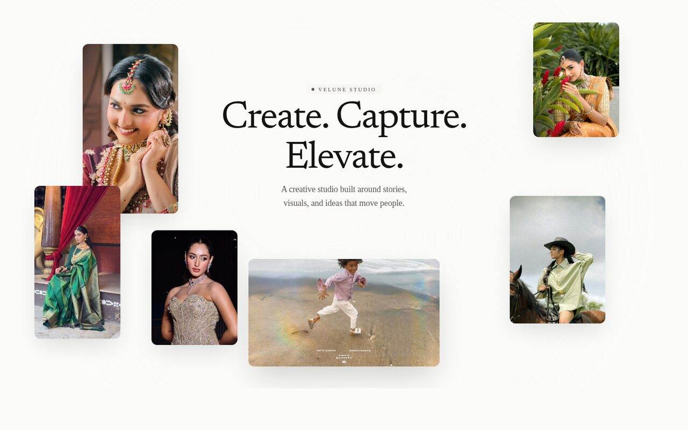

# Velune — Creative Studio Website

  

The public-facing website for Velune, a creative studio focused on stories, visuals, and ideas that move people.

Live site: https://velune-site.vercel.app

## Built with

- Next.js 16 and React 19
- TypeScript
- Tailwind CSS 4
- GSAP for motion
- Lenis for smooth scrolling

## Getting started

Use an active LTS version of Node.js, then install the exact dependency versions recorded in the lockfile:

~~~bash
npm ci
npm run dev
~~~

Open http://localhost:3000.

## Available commands

| Command | Purpose |
| --- | --- |
| npm run dev | Start the local development server |
| npm run lint | Run ESLint |
| npm run build | Create a production build |
| npm run start | Serve the production build |

## Website structure

- src/app/ — Next.js App Router layout and page
- src/components/ — reusable page sections and interface components
- src/lib/ — shared utilities and font setup
- src/styles/ — global styles
- docs/ — project notes and quality-assurance material
- AGENTS.md — repository-specific guidance for coding agents

The homepage is composed from the hero, manifesto, selected work, services, client roster, and contact sections.

## Quality checks

Before submitting a change, run:

~~~bash
npm run lint
npm run build
~~~

There is currently no dedicated automated unit-test script. Check user-visible changes at desktop and mobile widths, keyboard navigation, reduced-motion preferences, and browser-console output.

## Deployment

The project is currently associated with the Vercel deployment above. Production deployment settings and environment variables are managed in the hosting account, not stored in this repository.

## Security and contribution

See [CONTRIBUTING.md](CONTRIBUTING.md), [SECURITY.md](SECURITY.md), [CODE_OF_CONDUCT.md](CODE_OF_CONDUCT.md), and [SUPPORT.md](SUPPORT.md). Never commit secrets or private client material.

## License and asset rights

All rights reserved. The code is public for portfolio viewing only and is not open source; see [LICENSE](LICENSE). The Velune name, logo and brand identity belong to Velune Creative Studio. Photographs, videos and other client work belong to Velune Creative Studio and/or the respective clients and may not be reused.
